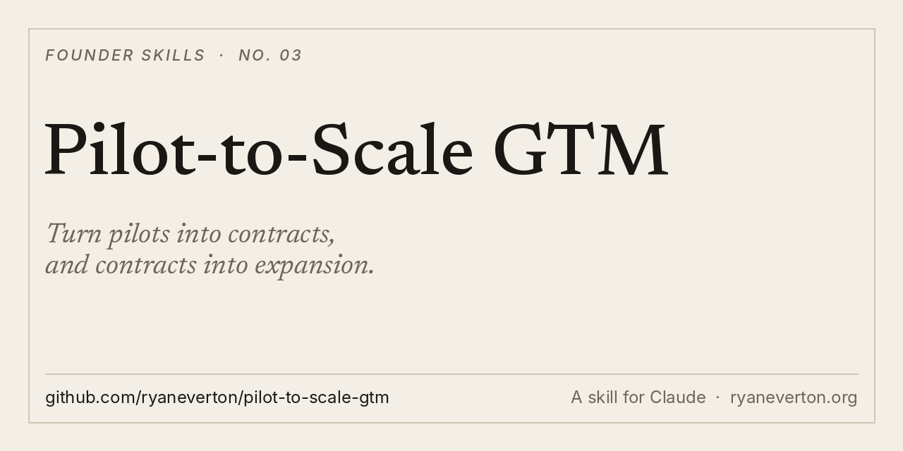

<p align="center"></p>

# Pilot-to-Scale GTM

**Turn pilots into contracts, and contracts into expansion.**

A skill for Claude and other agents. Pilot design, implementation speed, competitive response, AI-fluent hiring and brand spend, mapped to your stage. Every answer ends with one next action, one owner and one metric.

[Install](#install) · [What it makes](#what-it-makes) · [Use it](#use-it) · [Why I built it](#why-i-built-it)

## What it makes

- **Pilot plans that convert.** 2 to 4 weeks, 2 or 3 use cases, the customer keeps what they build, and the ROI story your champion takes to their boss.
- **Implementation plans that drive retention.** Time to value in weeks, the golden path, crawl, walk, run.
- **Competitive responses.** Their claim, your answer, the trap question, the proof point.
- **Hiring calls.** Domain expert or tech operator first, and how to screen for AI fluency.
- **A reality check.** It flags premature process. A pre-PMF team doesn't need a ramp dashboard.

## Install

**Claude Code**

```
/plugin marketplace add ryaneverton/pilot-to-scale-gtm
/plugin install pilot-to-scale-gtm@pilot-to-scale-gtm
```

**Any agent (Cursor, Codex, Gemini CLI and more)**

```
npx skills add ryaneverton/pilot-to-scale-gtm
```

**Claude app (web and desktop)**

1. Download [pilot-to-scale-gtm.zip](https://github.com/ryaneverton/pilot-to-scale-gtm/raw/main/dist/pilot-to-scale-gtm.zip)
2. In Claude, open **Customize › Skills**, click **+**, then **Create skill › Upload a skill**
3. Upload the ZIP

**Manual**

```
git clone https://github.com/ryaneverton/pilot-to-scale-gtm
cp -r pilot-to-scale-gtm/skills/pilot-to-scale-gtm ~/.claude/skills/
```

## Use it

- "Design a 3-week pilot for [customer] that converts."
- "Our pilots don't convert. Here's what we do today: [...]. Fix it."
- "[Competitor] just shipped [feature]. Give me the response for our late-stage deals."
- "Should our next hire be a domain expert or an engineer?"

## Why I built it

Getting the meeting is half of go-to-market. The other half is what happens after the yes. Category-creation companies rarely lose to competitors. They lose by not being in the room, or by being slow to get the customer to value.

This skill distils Legora's playbook for scaling a vertical AI company with a direct sales motion into decisions you can make this week.

## Pairs with

- [leverage-playbook](https://github.com/ryaneverton/leverage-playbook): who makes the business big
- [gtm-execution-playbook](https://github.com/ryaneverton/gtm-execution-playbook): how to sell it week to week
- [founder-daily-operator](https://github.com/ryaneverton/founder-daily-operator): run several companies with agents, safely

## About

Built by [Ryan Everton](https://ryaneverton.org). I write [The Intuitive Founder](https://ryaneverton.substack.com), on pragmatic AI and the inner work of building something real.

If this helped, star the repo: [@ryandeverton](https://x.com/ryandeverton).

MIT License.
